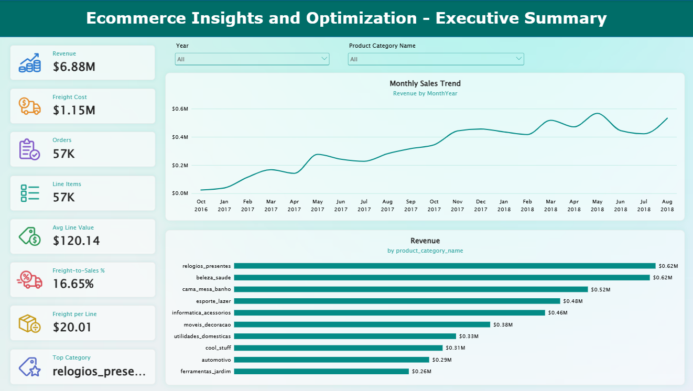
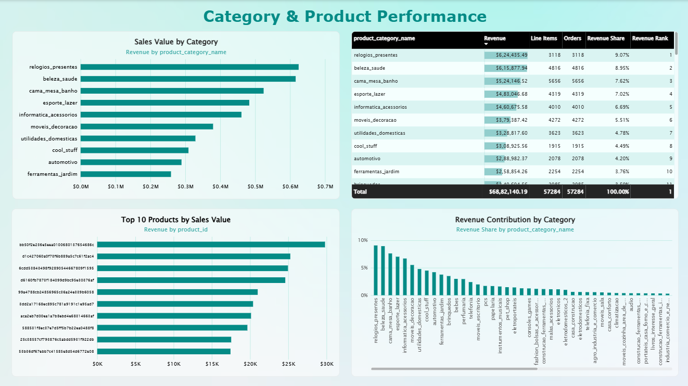
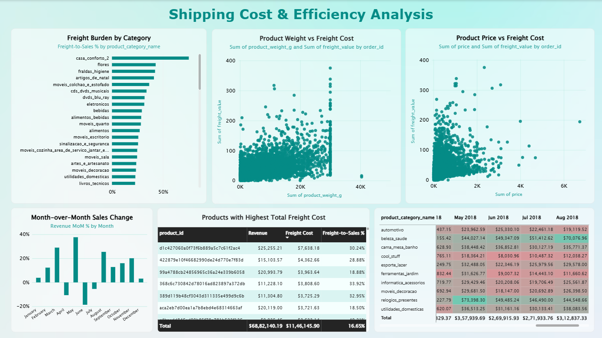
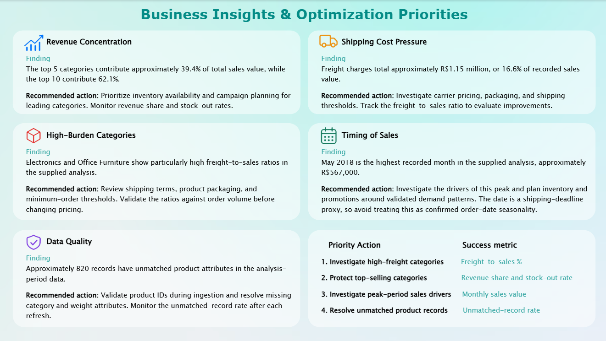

[README.md](https://github.com/user-attachments/files/33525086/README.md)
# Ecommerce Insights & Optimization

An end-to-end **data analytics and business intelligence project** that uses **SQL, Python, Excel, and Power BI** to investigate e-commerce category performance, product-level sales, shipping-cost exposure, and time-based sales patterns. The goal is to turn transactional data into evidence-based business findings and practical recommendations.

## Project Overview

E-commerce teams generate data about orders, products, pricing, shipping, and time-based activity. This project follows the analytics lifecycle—from data inspection and preparation to exploratory analysis, dashboarding, and business recommendations—to answer three central questions:

1. Which product categories and products contribute most to recorded sales value?
2. Which products or categories show a high shipping-cost burden relative to sales?
3. How does recorded sales activity vary over time, and what should the business investigate further?

The project brief emphasizes that charts alone are not enough: every major observation should be supported by evidence, interpreted in a business context, and connected to a measurable action.

## Business Objectives

- Inspect, clean, validate, and document the available data.
- Use SQL to query, join, aggregate, rank, and summarize sales and shipping data.
- Use Python for exploratory data analysis (EDA), data-quality checks, and analytical visualizations.
- Use Excel PivotTables, formulas, and summary views to reproduce and validate selected results.
- Build an interactive Power BI dashboard with reusable DAX measures.
- Analyze category performance, product concentration, shipping burden, and monthly patterns.
- Provide actionable recommendations while documenting assumptions and limitations.

## Tools & Technologies

| Tool | Role in the project |
|---|---|
| **SQL** | Data inspection, joins, filtering, aggregations, category/product rankings, shipping analysis, and date-based analysis. |
| **Python** | EDA and data auditing with pandas and NumPy; visualizations with matplotlib (and seaborn where useful). |
| **Excel** | PivotTables for category sales, monthly sales, and shipping by category; formula-based checks and a management summary. |
| **Power BI** | Interactive report pages, KPI cards, slicers, tables, and charts. |
| **DAX** | Reusable measures for sales value, freight cost, contribution, ranking, and month-over-month change. |
| **Power Query** | Data loading, filtering, type conversion, and preparation before reporting. |
| **CSV** | Source/analytical data format. |

## Dataset Overview

The dashboard uses the prepared analytical file `dashboard_data.csv`.

| Attribute | Details |
|---|---:|
| Original records | 57,373 |
| Records retained for the analysis period | 57,284 |
| Product categories | 74 |
| Distinct products | 21,629 |
| Sales-value field | `price` |
| Freight field | `freight_value` |
| Date field used in the dashboard | `ship_date` (a proxy, not a confirmed order date) |
| Unmatched product-attribute records | Approximately 820 in the analysis-period extract |

The project brief describes the underlying data model as order-item transaction data joined to a product master. Field names, keys, units, data types, missing values, duplicate business keys, and the meaning of price and shipping fields should be inspected rather than assumed.

## End-to-End Workflow

### 1. Data Understanding & Preparation

- Inspect row counts, columns, data types, sample records, and summary statistics.
- Check missing values, duplicate rows, duplicate business keys, invalid dates, and unusual numeric values.
- Validate product identifiers and investigate unmatched product records.
- Standardize data types, dates, and category values where needed.
- Confirm units for product weight and dimensions.
- Join transaction and product attributes using the validated product key.
- Document transformation rules and compare key totals before and after data preparation.

### 2. SQL Analysis

SQL supports structured analysis and repeatable aggregations. The workflow follows the project brief's SQL requirements, including:

- `SELECT`, `WHERE`, `ORDER BY`, `GROUP BY`, and `HAVING`
- Aggregate functions such as `SUM`, `COUNT`, `AVG`, `MIN`, and `MAX`
- `INNER JOIN` and `LEFT JOIN` for combining transaction and product data and investigating unmatched keys
- `CASE WHEN`, subqueries, and common table expressions (CTEs)
- Date functions for monthly and yearly analysis
- Window functions such as `RANK`, `DENSE_RANK`, and `LAG`
- Safe division and null handling

**Business analyses:** category sales value, top products, category rankings, shipping cost and shipping-to-sales ratio, monthly totals, peak period identification, and month-over-month change. Metric definitions depend on the validated grain and meaning of the available fields.

### 3. Python Exploratory Data Analysis (EDA)

Python is used to inspect data quality and explore patterns before communicating findings. The EDA workflow is organized as:

1. Load data and inspect dataset shape and sample records.
2. Audit data types, missing values, duplicates, and descriptive statistics.
3. Clean and standardize fields where justified; inspect outliers rather than silently removing them.
4. Merge transaction and product information using a validated key.
5. Create and validate analytical metrics.
6. Explore category performance, shipping burden, product attributes, and monthly patterns.
7. Create charts with descriptive titles, meaningful units, and written interpretation.
8. Translate findings into business implications and potential actions.

Expected analyses include category sales charts, top-product rankings, monthly trends, product weight versus freight, price versus freight, shipping-cost distributions, and revenue-contribution analysis.

### 4. Excel Analysis & Validation

Excel is used to reproduce selected analyses and create a spreadsheet-friendly summary for business users. The project brief specifies:

- PivotTable for category sales value
- PivotTable for monthly sales value
- PivotTable for shipping cost by category
- Appropriate formulas such as `SUMIFS`, `COUNTIFS`, `AVERAGEIFS`, and `XLOOKUP` (or `INDEX/MATCH`)
- A compact management summary with 4–6 KPIs and 3–5 charts
- Structured tables or data validation where useful
- Documentation of the source data and refresh process

Excel outputs can also be used as a cross-check for selected SQL and Power BI totals.

### 5. Power BI Dashboard

The Power BI model includes a calendar table (`DimDate`) related to `data[ship_date]` through an active one-to-many relationship. Date attributes support year, month, month number, and month-year analysis. DAX measures support the KPI cards, category comparisons, and monthly metrics.

The report is organized into five pages:

#### Page 1 — Executive Summary
An at-a-glance view of sales value, freight cost, order and line-item metrics, freight-to-sales ratio, average line value, monthly trend, leading category, and year/category filters.



#### Page 2 — Category & Product Performance
Compares sales value by category, identifies top products, and presents a category scorecard with revenue share and ranking.



#### Page 3 — Shipping Analysis
Examines freight-to-sales ratios by category, the relationship between product weight and freight, price versus freight, and products with high total freight charges.



#### Page 4 — Time Trends & Seasonality
Shows monthly sales trends, month-over-month changes, category-by-month patterns, and comparisons across time periods.



#### Page 5 — Insights & Actions
Summarizes evidence-based findings, prioritizes recommendations, and identifies KPIs to track the impact of future actions. Add a fifth screenshot if you want this page represented visually in the README.

## Key Findings

The following figures are based on the supplied analysis-period data and project analysis notes. Values are rounded for readability.

### Sales value and freight exposure

- **Recorded sales value:** approximately **R$6.88 million**.
- **Total freight charges:** approximately **R$1.15 million**.
- **Freight-to-sales ratio:** approximately **16.65%**.

Freight represents a meaningful share of recorded sales value and should be examined alongside category performance and sales volume.

### Revenue concentration and leading categories

- The top five categories contribute approximately **39.4%** of recorded sales value.
- The top ten categories contribute approximately **62.1%**.
- **Watches & Gifts** is the highest-revenue category, at approximately **R$625,000** (about **9.1%** of sales value).
- **Health & Beauty** contributes approximately **R$618,000** (about **9.0%**).

This concentration suggests that availability, assortment planning, and promotion decisions in leading categories merit attention.

### Categories with elevated freight-to-sales ratios

The supplied analysis notes elevated ratios for categories including:

- Electronics: approximately **31.7%**
- Office Furniture: approximately **25.8%**
- Furniture & Decor: approximately **23.6%**
- Housewares: approximately **23.0%**
- Bed/Bath/Table: approximately **19.8%**

These are candidates for further investigation, not proof of poor profitability. Ratios should be reviewed with order counts and other available operational factors.

### Time patterns and product characteristics

- **May 2018** recorded the highest monthly sales value in the supplied analysis, at approximately **R$567,000**.
- The supplied analysis notes a moderate positive association between product weight and freight cost (Spearman correlation approximately **0.45**) and between price and freight (approximately **0.44**).

These relationships are exploratory. Correlation does not prove causation, and the date field is a shipping-deadline proxy rather than a confirmed order date.

## Business Recommendations

| Priority area | Recommended action | KPI to monitor |
|---|---|---|
| Shipping optimization | Investigate carrier pricing, packaging, shipping service, and minimum-order thresholds for high-burden categories. | Freight-to-sales ratio; freight per line |
| Category management | Protect availability for leading categories and review the promotion calendar. | Category revenue share; stock-out rate |
| Product strategy | Investigate the drivers of performance in Watches & Gifts and Health & Beauty. | Sales value; campaign return where available |
| Time-based planning | Validate the drivers of monthly peaks before adjusting stock or campaigns. | Monthly sales value; stock availability |
| Data quality | Validate product identifiers and resolve unmatched product attributes during ingestion. | Unmatched-record rate |

These are proposed actions, not guaranteed savings. Their impact should be evaluated with before-and-after measurements and relevant operational data.

## Key Metrics & DAX Measures

The Power BI dashboard uses measures such as:

- `Revenue` — `SUM(data[price])`
- `Freight Cost` — `SUM(data[freight_value])`
- `Orders` — distinct count of `order_id`
- `Line Items` — count of rows in the analytical table
- `Avg Line Value` — recorded sales value divided by line-item count
- `Freight-to-Sales %` — freight cost divided by recorded sales value
- `Freight per Line` — freight cost divided by line-item count
- `Revenue Share %` — category sales value as a proportion of total sales value under the relevant filter context
- `Revenue Rank` — category rank by recorded sales value
- `Revenue MoM %` — month-over-month change in recorded sales value

## Limitations & Assumptions

- **Sales value is not profit.** Cost of goods sold, complete margin information, discounts, returns, taxes, and other costs are not available in the supplied analytical dataset.
- **Date proxy.** `ship_date` represents a shipping-deadline proxy, not a confirmed order date; time patterns should be described accordingly.
- **Quantity field.** A dedicated quantity column is unavailable in the prepared analytical file. Line-item counts are not automatically equivalent to verified physical units sold.
- **Order grain.** The supplied extract reports each `order_id` as unique. Validate the source grain before interpreting the Orders measure as transaction volume or calling average line value “average order value.”
- **Unmatched product attributes.** Approximately 820 analysis-period records lack matched product attributes, limiting some category and weight analyses.
- **Shipping definitions.** Confirm whether freight is stored per line item, order, or product before generalizing the metric beyond this prepared dataset.
- **Association versus causation.** Product weight or price associations do not prove they cause higher freight charges.
- **Seasonality.** A limited historical window cannot by itself prove recurring seasonality; one-time spikes and data issues should be investigated.

## Repository Structure

A recommended structure for the full project is:

```text
Ecommerce_Insights_and_Optimization/
├── data/
│   └── dashboard_data.csv                 # Include only if redistribution is permitted
├── sql/
│   └── ecommerce_analysis.sql
├── python/
│   └── ecommerce_eda.ipynb
├── excel/
│   └── ecommerce_analysis.xlsx
├── dashboard/
│   └── Ecommerce_Insights_and_Optimization.pbix
├── report/
│   └── Ecommerce_Insights_and_Optimization_Final_Report.pdf
├── screenshots/
│   ├── 1.png
│   ├── 2.png
│   ├── 3.png
│   └── 4.png
└── README.md
```

The filenames above are recommended names. Adjust them to match the files actually included in the repository. Do not list a deliverable as completed unless the corresponding file or analysis is available.

## How to Use

1. Clone or download the repository.
2. Open the SQL script in your SQL environment and configure the source tables or paths as documented in the script.
3. Open and run the Python notebook from top to bottom, updating data paths if needed.
4. Open the Excel workbook to review PivotTables and summary analysis.
5. Open `dashboard/Ecommerce_Insights_and_Optimization.pbix` in Power BI Desktop.
6. If prompted, update the data source path to the local analytical CSV and refresh the model.
7. Explore the dashboard using the year and category slicers.
8. Read the final report for the business findings, recommended actions, assumptions, and limitations.

## Conclusion

This project follows an end-to-end analytics approach: **SQL** supports structured querying and aggregation, **Python** supports exploratory analysis and visualization, **Excel** supports validation and management-friendly summaries, and **Power BI** communicates the results through an interactive dashboard.

The analysis indicates that sales value is concentrated in a relatively small set of categories and that freight charges are a meaningful proportion of recorded sales value. Combining category contribution with normalized shipping metrics provides a more useful decision basis than looking at total sales or total freight alone. The results also highlight the importance of data quality, validated metric definitions, and transparent limitations.

The next step toward a stronger profitability assessment would be to integrate cost of goods sold, discount and return data, confirmed order dates, and fuller shipping information such as destination, carrier, dimensions, and service level.

## Project Deliverables

The project brief defines the following deliverables. Include each item in the repository when the corresponding work is available:

- SQL analysis script
- Python EDA notebook
- Excel analysis workbook / management summary
- Power BI dashboard
- Final report with evidence-based insights and recommendations
- Data dictionary documenting definitions, assumptions, and quality issues

---

## Author

**Md Khaleel Ur Rahman**  
Data Analytics | SQL | Python | Excel | Power BI | DAX | Business Intelligence
